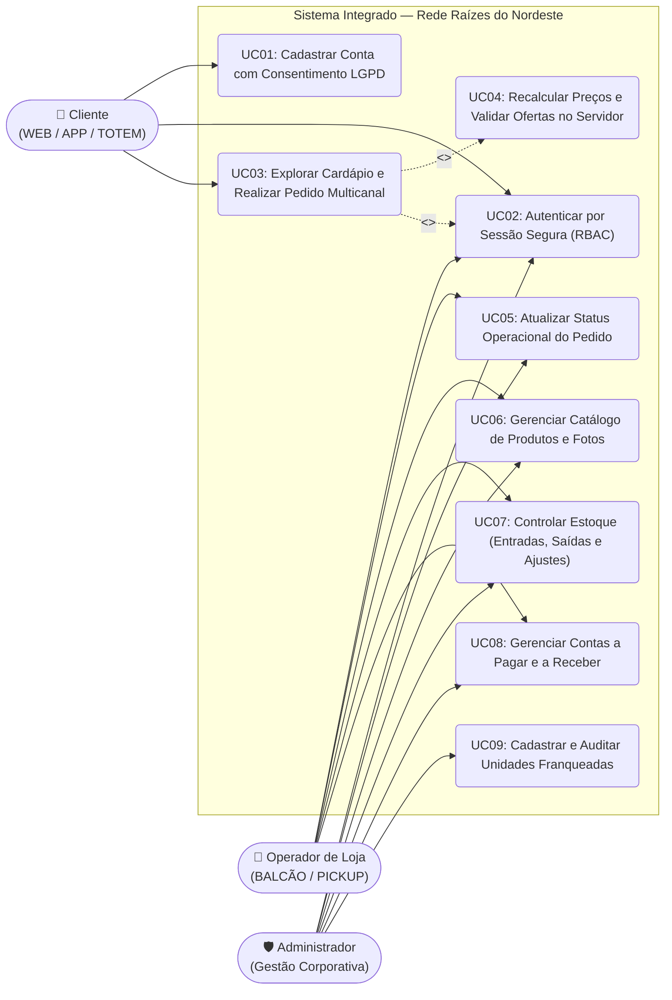

# Documento de Engenharia de Requisitos — Rede "Raízes do Nordeste"

**Projeto Multidisciplinar — Trilha: Qualidade de Software (UNINTER 2026)**  
**Docente:** Prof. Me. Rodrigo Nascimento | **Responsável:** Ronaldo Coutinho

---

## 1. Requisitos Funcionais (RF)

| ID | Requisito Funcional | Endpoints / Componentes | Critério de Aceitação Objetivo | Situação |
|---|---|---|---|---|
| **RF-01** | **Gestão de Unidades Franqueadas:** Cadastrar e listar unidades da rede com validação de sigla de UF e bloqueio de códigos duplicados. | `GET /api/unidades` `POST /api/unidades` | Cadastro válido retorna `HTTP 201`; código repetido retorna `HTTP 409`; sem autorização retorna `HTTP 401`/`503`. | **Implementado e Homologado** |
| **RF-02** | **Catálogo Padronizado e Combos:** Manter cardápio de 100 produtos regionais categorizados (`Lanches`, `Pratos`, `Bebidas`, `Sobremesas`, `Ofertas`), incluindo 21 combos com itens inclusos e imagens locais. | `GET /api/products` `POST / PUT / DELETE /api/products` `public/products.js` | 100 itens únicos com preços, ofertas (0–100%), imagens locais em `/imagens/` e fallback por categoria; escrita restrita a `admin` e `loja`. | **Implementado e Homologado** |
| **RF-03** | **Cadastro de Clientes e Consentimento LGPD:** Registrar clientes com validação de consentimento explícito LGPD, e-mail único e senha criptografada com `bcryptjs` (12 rounds). | `POST /api/auth/register` `public/login.html` | Senha nunca trafega ou persiste em texto puro; `lgpdConsent: false` ou tag HTML no nome retorna `HTTP 400`; e-mail repetido retorna `HTTP 409`. | **Implementado e Homologado** |
| **RF-04** | **Autenticação por Sessão e RBAC:** Autenticar perfis (`cliente`, `loja`, `admin`) via cookies assinados HMAC (`HttpOnly`, `Secure`, `SameSite=Lax`) e bloquear escalonamento de privilégio. | `POST /api/auth/login` `POST /api/auth/logout` `GET /api/auth/me` `POST /api/auth/migrate-local-users` | Sessões válidas por 7 dias persistidas no banco; assinaturas forjadas ou expiradas retornam `HTTP 401`; migração força papel `cliente`. | **Implementado e Homologado** |
| **RF-05** | **Pedidos Multicanal com Cálculo no Servidor:** Receber pedidos pelos canais `WEB`, `APP`, `TOTEM`, `BALCAO` e `PICKUP` (*Delivery*, *Retirada*, *Balcão*, *Totem*), recalculando preços e descontos no backend. | `POST /api/orders` `GET /api/orders` `POST /api/orders/migrate-local` `public/cliente.js` | Valores enviados pelo navegador são ignorados e recalculados no servidor; clientes veem apenas seus próprios pedidos; migração é idempotente por `legacyId`. | **Implementado e Homologado** |
| **RF-06** | **Acompanhamento e Ciclo Operacional do Pedido:** Permitir atualização do status do pedido pela loja ou administração. | `PATCH /api/orders/:id/status` `public/operacional.js` | Aceita apenas status válidos (`Em preparo`, `Em rota`, `Concluído`, `Cancelado`); bloqueia clientes (`HTTP 403`) e retorna `HTTP 404` para ID inexistente. | **Implementado e Homologado** |
| **RF-07** | **Controle de Estoque Auditado:** Consultar níveis de estoque (Crítico ≤ 5, Atenção 6–10, Normal > 10) e registrar movimentações (`entrada`, `saida`, `ajuste`). | `GET /api/estoque/resumo` `GET /api/estoque/movimentacoes` `POST /api/estoque/movimentacao` `public/gestao.js` | Acesso restrito a `admin` e `loja`; estoque nunca fica negativo em saídas; gera trilha de auditoria com responsável, motivo e saldo anterior/novo. | **Implementado e Homologado** |
| **RF-08** | **Gestão Financeira (Contas a Pagar e Receber):** Cadastrar títulos financeiros, consultar fluxo de caixa projetado/realizado, dar baixa (`pago`/`pendente`) e excluir lançamentos. | `GET / POST /api/financeiro` `GET /api/financeiro/resumo` `PATCH /api/financeiro/:id/status` `DELETE /api/financeiro/:id` | Acesso restrito a `admin` e `loja`; valida datas reais de calendário ISO (`YYYY-MM-DD`), valores positivos e sanitização contra XSS. | **Implementado e Homologado** |

---

## 2. Requisitos Não Funcionais e de Qualidade Mensuráveis (RNF / ISO 25010)

**Feature Crítica Selecionada:** *Processamento Transacional de Pedidos Multicanal com Cálculo Centralizado no Servidor e Gestão Integrada de Estoque/Financeiro*.

| ID | Atributo (ISO/IEC 25010) | Condição Mensurável / Meta | Método de Verificação | Critério de Aceitação | Situação |
|---|---|---|---|---|---|
| **RNF-01** | **Desempenho (Performance)** | Tempo de resposta das rotas transacionais de pedidos, estoque e catálogo inferior a `1500 ms` no percentil 95 (p95). | Cronometragem automatizada via Supertest na suíte `node --test`. | Latência média < `250 ms` e p95 < `1500 ms`. | **Atendido** (~180 ms) |
| **RNF-02** | **Disponibilidade (Availability)** | Disponibilidade operacional simulada ≥ `99,5%` com operação 100% autônoma offline (zero CDNs externos). | Monitoramento de `/api/health` e execução da suíte `src/offline.test.js`. | `HTTP 200` em 100% das checagens e zero dependências externas. | **Atendido** (100% local) |
| **RNF-03** | **Segurança (Security - Anti-Fraude)** | Rejeição absoluta de manipulação de preços no cliente e neutralização de payloads XSS (`<`, `>`) e coerção de tipos (`null`, `boolean`). | Testes de abuso em `src/app.test.js` e `src/faults.test.js`. | Total recalculado no servidor; payloads maliciosos recebem `HTTP 400`. | **Atendido** |
| **RNF-04** | **Segurança (Anti-Brute Force & Headers)** | Bloqueio de força bruta no login após 5 tentativas por IP em 15 min (`HTTP 429`) e presença de cabeçalhos Helmet/CSP. | Testes automatizados em `src/app.test.js` (CT-01 e CT-10). | 6ª tentativa retorna `HTTP 429` com cabeçalho `Retry-After`. | **Atendido** |
| **RNF-05** | **Usabilidade (Usability)** | Conclusão do pedido em ≤ 3 interações a partir do carrinho e login demonstrativo em 1 clique. | Inspeção nos fluxos de `public/cliente.html` e `public/login.html`. | Checkout em ≤ 3 cliques com feedback claro em `aria-live="polite"`. | **Atendido** |
| **RNF-06** | **Confiabilidade e Persistência (Reliability)** | Persistência ACID em SQLite (`journal_mode = WAL`, `foreign_keys = ON`) e idempotência na migração de pedidos/contas. | Testes de reabertura de conexão e migração repetida (`CT-14`, `CT-34`). | Zero perda de dados após reconexão e zero duplicação por `legacyId`. | **Atendido** |
| **RNF-07** | **Compatibilidade e Responsividade** | Adaptação fluida entre `320 px` (mobile/totem) e `1920 px` (desktop) sem rolagem horizontal indevida. | Validação de CSS Grid/Flexbox local em `public/style.css`. | 0 barras de rolagem horizontal e suporte a `prefers-reduced-motion`. | **Atendido** |
| **RNF-08** | **Manutenibilidade e Testabilidade** | Suíte automatizada executável em comando único (`npm test`) em banco temporário isolado em menos de 60 segundos. | Execução das 5 suítes (`35 testes`) via Node.js Test Runner. | 35/35 testes aprovados (100% de sucesso) em ~35 segundos. | **Atendido** |

---

## 3. Diagrama de Casos de Uso (UML / Mermaid)

---

## 4. Especificações Detalhadas de Casos de Uso (Modelo UNINTER)

### UC01 — Cadastrar Cliente com Consentimento LGPD
- **Descrição:** Permite que um visitante crie uma conta de cliente com aceite explícito de tratamento de dados (LGPD) e senha criptografada.
- **Ator Principal:** Cliente (Web / Mobile).
- **Pré-condições:** O e-mail informado ainda não deve estar cadastrado na tabela `users`.
- **Pós-condições:** Conta criada com perfil restrito `cliente` e senha salva como hash `bcryptjs` (custo 12).
- **Fluxo Base:**
  1. O usuário acessa a tela de login (`login.html`) e aciona "Criar conta de cliente".
  2. O usuário preenche Nome, E-mail, Senha (8 a 128 caracteres) e marca o termo de consentimento LGPD.
  3. O sistema valida os formatos, bloqueia tags HTML (`<`, `>`) e envia `POST /api/auth/register`.
  4. O servidor grava o registro e retorna `HTTP 201 Created`.
- **Fluxos Alternativos / Exceções:**
  - *FA1 — Consentimento LGPD recusado:* O sistema bloqueia o envio e retorna `HTTP 400`.
  - *FA2 — E-mail já existente:* O servidor retorna `HTTP 409 Conflict` ("Este e-mail já está cadastrado.").

### UC03 — Realizar Pedido Multicanal com Cálculo Centralizado
- **Descrição:** Permite ao cliente montar o carrinho, escolher loja, região, forma de pagamento simulada e modalidade (`Delivery`, `Retirada`, `Balcão` ou `Totem`) e registrar o pedido.
- **Ator Principal:** Cliente autenticado.
- **Pré-condições:** Usuário autenticado com perfil `cliente` e carrinho contendo entre 1 e 50 itens válidos.
- **Pós-condições:** Pedido persistido na tabela `orders` com status inicial `Em preparo` e valor total recalculado pelo servidor.
- **Fluxo Base:**
  1. O cliente filtra produtos no cardápio (`cliente.html`) e adiciona itens ao carrinho.
  2. O cliente seleciona a unidade, região, modalidade de atendimento e forma de pagamento (`Pix`, `Cartão` ou `Dinheiro`).
  3. O cliente clica em "Finalizar pedido", disparando `POST /api/orders`.
  4. O servidor consulta a tabela `products`, aplica os descontos promocionais oficiais (`offer`), ignora qualquer preço adulterado vindo do cliente e retorna `HTTP 201`.
- **Regras de Negócio:**
  - *RN01:* Nenhum valor monetário enviado pelo frontend é confiado pelo backend.
  - *RN02:* Cada item do pedido deve ter quantidade inteira entre 1 e 100 unidades.
